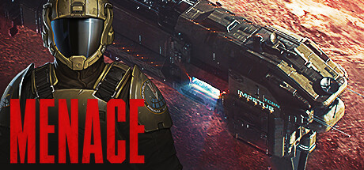

**MENACE by Overhype Studios (2025), developers of Battle Brothers, is a sci-fi turn-based tactics game.**

---

## 📖 About

MENACE by Overhype Studios (2025), developers of Battle Brothers, is a sci-fi turn-based tactics game. You command squads of marines against alien threats across procedurally generated campaigns. From the team that made Battle Brothers, expect equally brutal consequences for tactical mistakes.

## ⚠️ Problems Without Trainer

| Problem | Status |
|---------|--------|
| Overwatch shots miss at critical moments leaving squads exposed to counterattacks | ✅ Solved |
| Squad wipes on missed missions escalate campaign difficulty past recovery point | ✅ Solved |
| Ammo scarcity across long campaigns forces passive play that loses objectives | ✅ Solved |
| Marine injury cascades between missions eroding effective unit count | ✅ Solved |
| Alien ambush spawns break carefully positioned overwatch grids without warning | ✅ Solved |

## ✅ Solution

The **MENACE Trainer** solves all these issues, giving you complete control so you can focus on enjoying the game.

## 🎯 Features

- Unlimited Resources / Currency
- God Mode / Invincibility
- Instant Skill & Ability Cooldown
- One-Hit Kill
- Freeze Timers
- Unlock All Items & Achievements
- Custom Speed Multiplier
- Infinite Stamina / Energy

## 🚀 Quick Start

1. **Disable Windows Defender** temporarily (trainer may trigger false positive)
2. Get the trainer from the button above
3. Launch MENACE
4. Run the trainer as Administrator
5. Use the hotkeys to activate cheats in-game

## 💎 Free vs Pro

| Feature | Free | Pro |
|---------|------|-----|
| God Mode | ✅ | ✅ |
| Unlimited Resources | ✅ | ✅ |
| Advanced Cheats | ❌ | ✅ |
| Auto-Updates | ❌ | ✅ |
| Priority Support | ❌ | ✅ |

## 💻 Requirements

- Windows 10 / 11 (64-bit)
- MENACE (any version)
- .NET Framework 4.8+
- DirectX 11+

## 🍎 macOS

## ⚖️ Legal

Educational and single-player use only.

---

